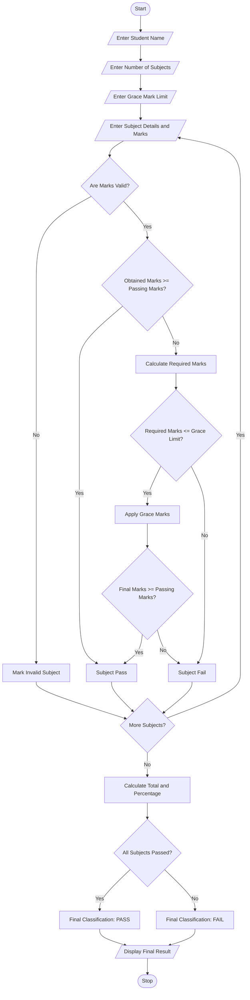

# Examination Result and Grace-Mark Validation System

## 1. Problem Statement

Develop a Python program to process examination marks of students across multiple subjects. The system should check subject-wise pass criteria, apply a specified grace-mark policy for students who are slightly below the passing marks, and generate the final examination result.

The program must ensure that:

- Marks are entered for multiple subjects.
- Each subject has a minimum passing mark.
- Grace marks are awarded only according to the specified policy.
- Grace marks must not exceed the maximum marks of a subject.
- Students are classified as Pass or Fail based on their final marks.
- The total marks and percentage are calculated.

## 2. Algorithm

1. Start the program.
2. Read the student's name.
3. Read the number of subjects.
4. Read the maximum marks, obtained marks, and minimum passing marks for each subject.
5. Read the maximum grace marks allowed.
6. Check each subject's marks:
   - If obtained marks are greater than or equal to passing marks, declare the subject as Pass.
   - Otherwise, calculate the marks required to pass.
   - If required marks are within the grace-mark limit, award grace marks.
   - Ensure final marks do not exceed maximum marks.
   - Otherwise, declare the subject as Fail.
7. Calculate total marks and percentage.
8. If all subjects are passed, declare the final result as Pass.
9. Otherwise, declare the final result as Fail.
10. Display subject-wise results, grace marks, total marks, percentage, and final classification.
11. Stop.

## 3. Flowchart

 

## 4. Python Source Code

```
# Examination Result and Grace-Mark Validation Systemprint("EXAMINATION RESULT AND GRACE-MARK VALIDATION")
student_name = input("Enter student name: ")
n = int(input("Enter number of subjects: "))
grace_limit = int(input("Enter maximum grace marks allowed: "))
total_marks = 0
total_maximum = 0
all_pass = True
for i in range(1, n + 1):
   print("\nSubject", i)
 subject = input("Enter subject name: ")
  maximum = int(input("Enter maximum marks: "))
  obtained = int(input("Enter obtained marks: "))
  passing = int(input("Enter passing marks: "))
  grace = 0
   # Validate marks
   if maximum <= 0 or passing < 0 or passing > maximum:
    print("Invalid subject marks or passing criteria")
   all_pass = False
   continue
 if obtained < 0 or obtained > maximum:
      print("Invalid obtained marks")
  all_pass = False
  continue
```

## 5. Sample Input

```
EXAMINATION RESULT AND GRACE-MARK VALIDATION

Enter student name: Rahul
Enter number of subjects: 3
Enter maximum grace marks allowed: 5

Subject 1
Enter subject name: Mathematics
Enter maximum marks: 100
Enter obtained marks: 65
Enter passing marks: 40

Subject 2
Enter subject name: Physics
Enter maximum marks: 100
Enter obtained marks: 37
Enter passing marks: 40

Subject 3
Enter subject name: Chemistry
Enter maximum marks: 100
Enter obtained marks: 80
Enter passing marks: 40
```

## 6. Sample Output

```
EXAMINATION RESULT AND GRACE-MARK VALIDATION

Subject: Mathematics
Final Marks: 65
Grace Marks: 0
Subject Result: PASS

Subject: Physics
Final Marks: 40
Grace Marks: 3
Subject Result: PASS

Subject: Chemistry
Final Marks: 80
Grace Marks: 0
Subject Result: PASS

========== FINAL RESULT ==========

Student Name: Rahul
Total Marks: 185 / 300
Percentage: 61.67 %
Final Classification: PASS
Grade: FIRST CLASS

==================================
```

## 7. Mermaid Flowchart Code

You can copy this code into [Mermaid Live Editor](https://mermaid.live/?utm_source=chatgpt.com) to generate the flowchart.

  

## 8. Expected Result

The program successfully:

1. Processes marks across multiple subjects.
2. Checks subject-wise passing requirements.
3. Applies grace marks when permitted.
4. Prevents marks from exceeding the maximum marks.
5. Calculates total marks and percentage.
6. Generates the final Pass/Fail classification and grade.

Conclusion: The Examination Result and Grace-Mark Validation System automates examination result processing while ensuring fair application of grace marks and accurate student classification.

Note: The grace-mark limit and grade boundaries in this example are configurable demonstration rules. Actual examination regulations may differ.
